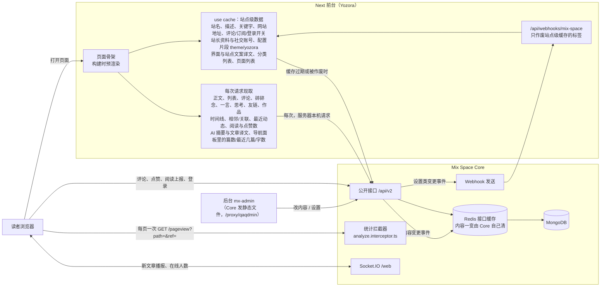

# Yozora 架构：缓存与统计（2026-11-07 讨论定的目标架构）

这是计划，不是现状。现状是“Next 用 `use cache` 缓存几乎所有数据 + Core 的 Redis 再缓存一层”，打算在正式切换之后单独做一轮改成下面这样。动手前先把 `blog-data.ts` 里每个读取函数归到哪一边列成表，给站长过目。

## 一张图

## 三层各管什么

**1. Next 的页面骨架。** 布局、页头页脚结构、读取中占位，构建时预渲染，打开页面立刻发出去；需要数据的部分在 Suspense 里流式补上。

**2. Next 的 `use cache`：只放站点级、很少变的数据。** `cacheLife("max")` 平时不过期，另留约一天的兜底过期，防止哪次 Webhook 没送到。作废靠少数几类 Webhook：

| 数据 | 作废事件 |
|---|---|
| 站名、站点描述、关键字、网站地址、评论开关、登录方式、订阅开关 | OPTION_UPDATE |
| 站长昵称、头像、社交账号 | OWNER_UPDATE |
| 配置片段 `theme/yozora` | SNIPPET_* |
| 界面文字与站点文案译文、开着的语言 | I18N_UPDATE |
| 分类列表、后台页面列表（导航骨架） | 分类、页面的增删改 |

**3. Core 的 Redis：内容数据只缓存在这一层。** 文章、手记、评论等每次都由 Next 现取 Core，Core 读 Redis，没有再查 Mongo。要补的一处：内容变更事件发生时就清 Redis（现在只在发 Webhook 前清，原版 Core 改内容时不清、靠短 TTL：普通接口 15 秒、聚合接口 10 分钟、RSS/sitemap 1 小时）。

规则（2026-11-09 修订）：谁拼出来的谁缓存。Core 的单次回答（一篇文章、一页列表、评论）只在 Redis；Next 用多次请求拼出来的东西（导航面板、时间线、条目索引、译名对照、列表里每条的 AI 摘要）放 Next，跟内容事件一起作废。两层不打架：Core 先清 Redis 再发 Webhook，Next 重新拼时读到的已是新数据。

## 不经过 Next 的请求（浏览器直连 Core）

- 访问统计：每打开一页 `GET /pageview?path=页面路径&ref=来源`，一页一条，IP 是读者自己的（2026-11-07 已做，线上待部署）。
- 评论、点赞、阅读上报、读者登录。
- 实时消息：Socket.IO（新文章播报、在线人数、站长“正在用/在听”的广播）。
- 后台：Core 发后台的静态文件并注入 `BASE_API=/api/v2`、`GATEWAY=后台设置的 Gateway 地址`，后台的接口请求和 Core 同域名。

## 后台三个统计数各是什么

| 后台显示 | 怎么来的 | 准不准 |
|---|---|---|
| API 调用次数 | 每个 GET 接口请求加一 | 准，本来就数接口 |
| 今日 IP 访问 | 按 IP 去重 | 准（要是读者的 IP） |
| 访问记录 / 访问趋势（PV） | 统计拦截器每个 GET 请求记一条 | 只有 `/pageview` 记的才代表页面浏览 |

转发读者 IP 照搬 Shiro（`attach-fetch.ts` 每次服务端请求带 `x-real-ip` / `x-forwarded-for`，Core 的 `getIp` 先读这两个头），限流按读者分开算；但 Shiro 这样做会让一页 SSR 调几个接口就记几条 PV、路径是接口地址，所以 Core 的访问记录改成只认 `/pageview`。改完后“API 调用次数”也只数页面浏览。
（原来写的“Next 服务器的请求来自本机 IP 所以不记”不对：Next 请求的是公网域名，Core 看到的是服务器公网 IP；实际没记是因为 Node 的 UA 被 isbot 当成爬虫。）

## 实施计划（2026-11-09 站长同意方向）

站长定：内网优先、公网兜底；读者 IP 随服务端请求转发；其余按推荐。每步单独提交、单独验证，线上部署另外征得同意。

0. **先造量具**：`scripts/measure-core-calls.mjs` 在 Core 前面挂一个只计数的转发代理，前台指向它，逐页打开（首页、文章列表、文章详情、手记、时间线、碎碎念、一言、友链、作品、外文页面），打印每页、每个接口各请求了几次，以及一次 Webhook 作废后重建要发多少请求。改前改后各跑一次，用数字确认扇出和限流余量。
   **改前基线（2026-11-09，开发模式）**：缓存热了以后每页 0–2 次（只有 `/ai/i18n`）；一次 POST_UPDATE Webhook 后同时打开 9 页，5.6 秒内 89 次，全是同一个 IP，离限流 100 只差一点；大头是列表每篇各一次 `/ai/summaries/article/:id` 和 `/ai/translations/article/:id/languages`（各 19 次）。所以第 4 步的内部密钥要做，不是可选。
   **改后（2026-11-09，生产构建 `next start`，开发模式会多渲染一遍、每个现取请求都翻倍，不能拿来量）**：缓存热了以后每页 0–5 次（首页 5：碎碎念、文章、手记、喜欢数、最近动态；详情 2：正文、评论；列表 1）；Webhook 后 9 页 5.5 秒 108 次，都是 Next 缓存重建，带内部密钥、Core 日志里 0 次限流。大头仍是列表每篇的 AI 摘要与译文语言（各 19 次），以后可以让 Core 出一个按 id 批量取的接口。实施中发现并修掉的两处：思考列表每条都挂评论区，改成现取后一页 20 次评论请求，现在 Core 列表里条数为 0 的不取；详情页 `generateMetadata` 不带 lang、正文带，React cache 按参数去重失败、一页请求两次，改为对 Core 的原始请求（corePost/coreNote/corePage）去重。站点级缓存的时长没有改长：改前实测平时每页只有 0–2 次，没有必要。
1. **Core：内容一变就清 Redis**（`webhook.service.ts`）。`cleanCatch` 挪到“有没有订阅 Webhook”的判断之前，`ACCEPT_EVENTS` 里的事件都清，访客在线、阅读数这类高频事件不清。测试：没配 Webhook 时改文章，下一次读到新值。
2. **Core：访问记录只认 `/pageview`**（`analyze.interceptor.ts`）。其他 GET 不再写访问记录、不计入今日 IP，但“API 调用次数”照旧数所有（没被跳过的）GET：只加计数、不写记录（站长 2026-11-09 定）。测试：普通接口 GET 不记录但计数加一，`/pageview` 记录且计数加一。
3. **前台：内网优先、公网兜底**。新增可选变量 `MIX_SPACE_INTERNAL_API_URL`（线上 `http://mx-server:2333/api/v2`）；服务端请求（`lib/api.ts` 的适配器、`lib/i18n/data.ts`）先走它，连不上（网络错误或超时，不是 4xx/5xx）就改走 `MIX_SPACE_API_URL` 并在 60 秒内直接走公网，之后再试内网。交给浏览器的地址仍是 `MIX_SPACE_API_URL`。只对 GET 兜底。测试：内网地址不通时页面照常、只等一次。
4. **前台：转发读者 IP**。每次请求现取的函数用带 IP 的客户端：从 openresty 写的 `x-real-ip` / `x-forwarded-for` 取读者 IP 放进请求头（Next 只监听 127.0.0.1，只有 openresty 能访问，所以这两个头可信）。放 Next 缓存的函数里不能读请求头，照旧不带 IP；如果第 0 步量出一次重建的请求数接近 100，Core 的限流对“带内部密钥、且没有转发 IP”的请求放行（新变量 `YOZORA_INTERNAL_KEY`，只放行限流，不算登录，不会多拿到草稿，Redis 缓存照常）。
5. **前台：按下表挪缓存层**。“现取”的函数去掉 `"use cache"`，用 React `cache()` 让同一次渲染里只请求一次（详情页 `generateMetadata` 和正文共用）；站点级改成长缓存 + 一天兜底；不再用到的标签从 Webhook 对照表、`cache-actions.ts` 白名单里删掉，访客写入后只需 `router.refresh`。
6. **验证**：第 0 步量具改后再跑一次；`pnpm verify`；相关 e2e（dev-issues、realtime-push、comment-enhance、list-filters、i18n-content、og-image、feed）；更新 AGENTS.md 与 `docs/admin-data-sources.md`。
7. **上线（需站长同意）**：重建 Core 镜像、前台；`docker network connect core_mx-space yozora-web`；生成一把随机 `YOZORA_INTERNAL_KEY`，同时写进 Core 的 compose 环境变量和前台 `web.env`，前台再加 `MIX_SPACE_INTERNAL_API_URL=http://mx-server:2333/api/v2`；回滚是换回旧镜像和旧前台版本、断开网络即可（两个变量不配时功能自动关闭，旧前台不受影响）。

**状态（2026-11-09）**：第 0–7 步都已完成，b30be94 已上线（Core 镜像 `yozora/mx-server:cache-b30be94`、前台 `releases/b30be94`），记录与回滚见 `docs/deploy-beta.md`。

不放过的风险：详情页 `generateMetadata` 改为现取后，Next 16 可能报“metadata 里有未缓存数据”（10-28、10-30 的同类问题），第 5 步要用 dev-issues 检查；页面更“动态”后读取中的小火箭会多出现，内网 + Redis 命中预计很快，以第 0 步实测为准。

## 读取函数分类表（`apps/web/lib/blog-data.ts` 等，2026-11-09）

**Next 缓存：站点级**（长缓存 + 一天兜底，靠设置类事件作废）

| 函数 | 作废事件 |
|---|---|
| getSiteSettings、getLoginProviders、getSubscribeOptions | OPTION_UPDATE |
| getOwner | OWNER_UPDATE |
| getThemeConfig（及 getSiteContent、getSiteDescription） | SNIPPET_*、I18N_UPDATE |
| `lib/i18n/data.ts`（界面与站点文案译文、开着的语言） | I18N_UPDATE |
| getCategories、getNavigationData | 分类、页面增删改 |
| getTopics、getTags | 手记 / 文章增删改（导航面板和右栏都要用，放 Next 免得被缓存函数间接调用） |
| `lib/activity-sky.ts`（页脚星带，取 GitHub 和力扣） | 不是 Core 数据，原样 |

**Next 缓存：Next 拼出来的**（跟内容事件作废，留一小时兜底）

| 函数 | 为什么不现取 |
|---|---|
| getNavigationPanels | 每页都渲染，每个话题各请求一次，再加时间线、站点信息 |
| getTimeline、getPostIndex、getNoteIndex、getLocalizedNames | 一次要翻完全部文章 / 手记，被相邻文章、关联阅读、标签和搜索结果、外文译名反复用 |
| getNotesByTopic | 导航面板和手记文末话题卡片用 |
| getHomeFeed（2026-11-14） | 首页第一屏下面那块（最新文章、手记、碎碎念、最近发生的事）；现取总比首屏晚到、往下滑还在读，放 Next 缓存后不包 Suspense、和首屏一起进页面骨架。挂文章、手记、碎碎念、评论、思考、AI 的标签（verify-blog-cache 检查），点赞没有事件、最多晚 5 分钟；读不到时退回现取 |
| getArticleAi、getArticleTranslation | 列表里每条一次（一页 10 次） |
| getFeedItems | RSS 每条都带全文和摘要，阅读器访问频繁 |

**现取（只靠 Core Redis，带读者 IP）**

| 函数 | 说明 |
|---|---|
| getPost、getNote、getPage | 正文一次；相邻 / 关联 / 译名从上面的 Next 缓存取 |
| getPosts、getNotes、getMatchedPosts、getMatchedNotes | 一页列表一次；每条 AI 摘要、条目索引从 Next 缓存取 |
| getComments | 主评论分页 + 楼中楼，读者发完立刻看得到 |
| getRecentActivity | 一次；文章地址借时间线缓存换算 |
| getLinks、getLinkApplyOpen、getAllSays、getMurmurs、getRecently、getProjects | 各一次 |
| getSiteLikes | 计数，本来就要新 |
| searchPosts、searchNotes | ⌘K 每次输入不同，Next 缓存命中率低 |

`og.ts`、`page-metadata.ts`、`article-body.tsx`（Shiki 高亮）、`note-unlock-action.tsx` 里的缓存不是取 Core 内容（或本来就不缓存），不动。

## 两个地址设置（Core 自己用，前台不读）

- API 地址（serverUrl）：OAuth 回调、退订链接、本地文件地址。
- Gateway 地址（wsUrl）：后台的实时连接。

前台连 Core：服务端先走 `MIX_SPACE_INTERNAL_API_URL`（Docker 内网），不通再走 `MIX_SPACE_API_URL`；交给浏览器的一律是 `MIX_SPACE_API_URL`（公网）。正式切换时这两项统一到 `api.sin6626.me`，细节见 `docs/deploy-beta.md`。
